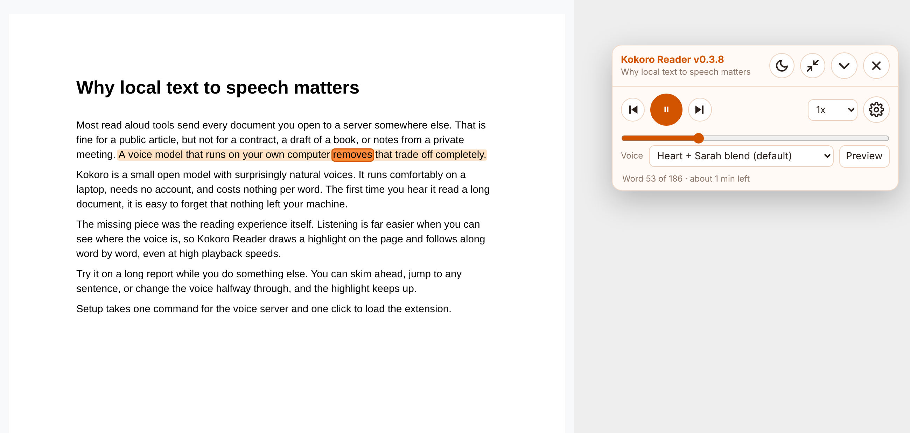

# Kokoro Reader

Read Google Docs aloud with a natural AI voice and a word by word highlight drawn right on the page. Free, open source and fully local, so your documents never leave your computer. A Speechify alternative with no subscription.



## Features

- Natural voices from [Kokoro-82M](https://huggingface.co/hexgrad/Kokoro-82M), running on your machine
- Word highlight plus a soft sentence highlight, in six colors
- Voice picker with preview and custom blends, speed from 0.8x to 3x
- Previous and next sentence, seek bar, auto scroll
- Alt+click any word to start from there
- Works on long docs, any zoom level, light and dark docs

## Install

**1. Voice server** (macOS or Linux, one command)

```bash
curl -fsSL https://raw.githubusercontent.com/hareesh-r/kokoro-reader/main/install.sh | bash
```

It sets up the Kokoro server and model (about 330 MB) and starts it at login. On macOS you can also double click `Install Kokoro Reader.command`. Manage it with `kokoro-reader status | start | stop | restart | logs | uninstall`.

Windows: use WSL, or run `docker run -p 8880:8880 ghcr.io/remsky/kokoro-fastapi-cpu`.

**2. Chrome extension**

1. Download the zip from [Releases](../../releases) and unzip it, or use the `extension` folder of this repo
2. Open `chrome://extensions` and turn on Developer mode
3. Click Load unpacked and pick the extension folder
4. Open a Google Doc and press Alt+Shift+L

## Use

| Action | How |
| --- | --- |
| Open or close the panel | Alt+Shift+L |
| Play or pause | Alt+Shift+P |
| Previous or next sentence | Left and Right arrows |
| Start from a word | Alt+click it |
| Change voice | Voice dropdown, then Preview |

Shortcuts can be changed at `chrome://extensions/shortcuts`. For a custom voice blend choose Custom blend and join voices with a plus, for example `af_bella+af_nicole`.

| Dark docs | Settings |
| --- | --- |
|  |  |

## Troubleshooting

- **Cannot reach the server:** run `kokoro-reader status`, then `kokoro-reader start`
- **Audio plays but no highlight:** open Settings, press Check page match, and share the output in an issue
- **Highlight lost after zooming:** wait a second, or press Reload document text in Settings
- **No sound:** press play once, Chrome needs a click first
- **Port 8880 taken:** install with `KOKORO_PORT=9000` and update Server in Settings

To report a bug, press Copy debug report in Settings and paste it into an issue. It has timings and match scores only, no document text.

## How it works

Google Docs draws pages on canvas, so there is no text to highlight. The extension reads the doc text through the export endpoint, gets audio and word timestamps from your local server, then matches each rendered line and word on the page by pixel and letter width. The highlight is a transparent layer on top.

## Limits

- Chrome and Google Docs only for now
- Best with English. Kokoro has other languages but not Tamil
- Tables and drawings are matched loosely, and unusual fonts can reduce accuracy

## Privacy

The extension only talks to Google Docs and your local server. No analytics, no accounts, no cloud voice.

## Development

`extension/` is the Manifest V3 extension, `server/` is the `kokoro-reader` command, `scripts/build-extension.sh` makes the release zip. Pushing a tag like `v0.3.8` publishes a release through GitHub Actions.

## Credits

Voice model by [hexgrad](https://huggingface.co/hexgrad/Kokoro-82M), server by [remsky/Kokoro-FastAPI](https://github.com/remsky/Kokoro-FastAPI). Not affiliated with Google or Speechify.

## License

MIT, see [LICENSE](LICENSE).
