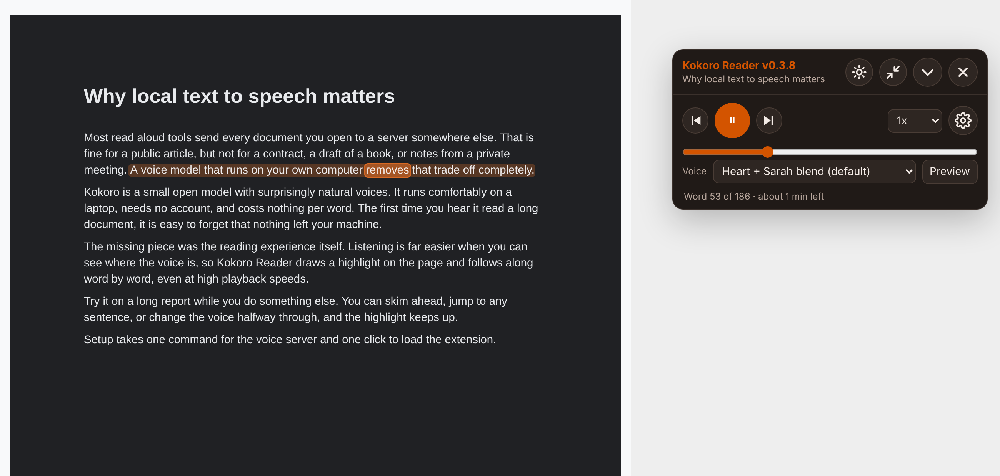
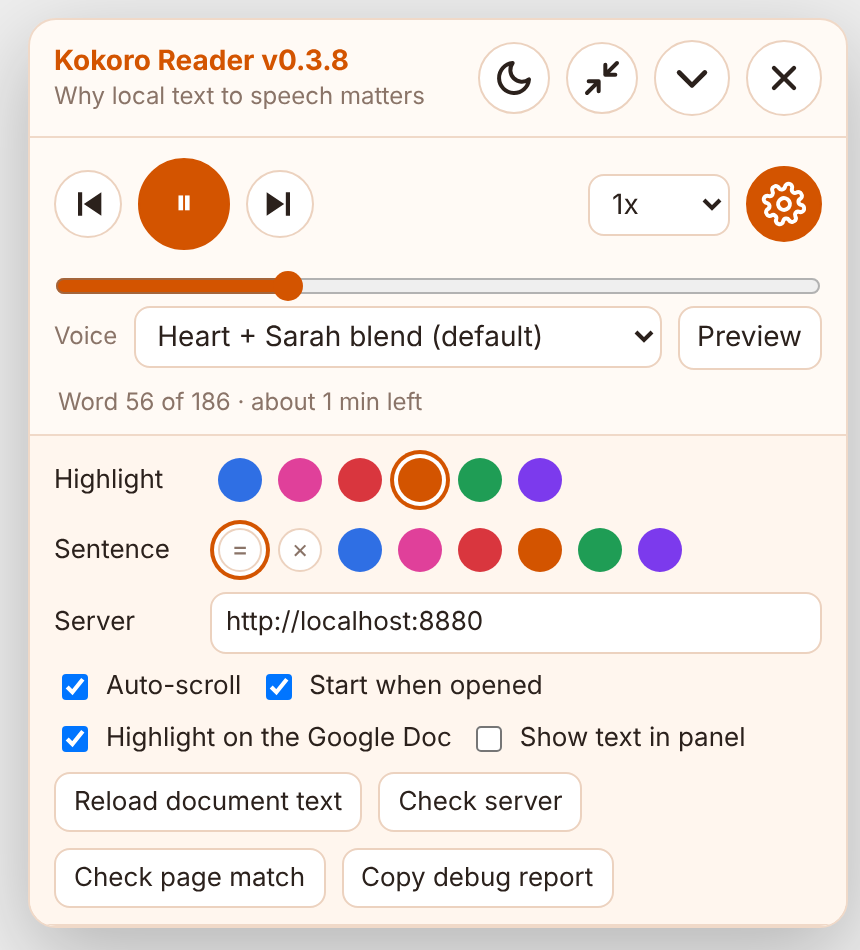

# Kokoro Reader

Read any web page or Google Doc aloud with a natural AI voice and a word by word highlight drawn right on the page. Free, open source and fully local, so your text never leaves your computer. A Speechify alternative with no subscription.


## Features

- Natural voices from [Kokoro-82M](https://huggingface.co/hexgrad/Kokoro-82M), running on your machine
- Word highlight plus a soft sentence highlight, in six colors
- Voice picker with preview and custom blends, speed from 0.8x to 3x
- Previous and next sentence, seek bar, auto scroll
- Alt+click any word to start from there
- Works on any website: reads your selection, or the main article if nothing is selected
- Works on long docs, any zoom level, light and dark docs

## Install

Download from the [latest release](../../releases/latest):

| Your system | Download |
| --- | --- |
| macOS | `KokoroReader-x.y.z.dmg`, open it and double click Install Kokoro Reader |
| Windows | `KokoroReader-Setup-x.y.z.exe` |
| Chrome extension | `kokoro-reader-extension-x.y.z.zip` |

The installers set up the local voice server and download the voice model (about 330 MB). They are not code signed yet. On macOS, if double clicking does nothing, open System Settings, Privacy & Security, and click Open Anyway next to Install Kokoro Reader (or run the Terminal install below). On Windows, SmartScreen shows a warning: click More info, then Run anyway.

Then load the extension:

1. Unzip the extension, or use the folder the installer opened
2. Open `chrome://extensions` and turn on Developer mode
3. Click Load unpacked and pick the extension folder
4. Open any page or Google Doc and press Alt+Shift+L

**Terminal install (macOS or Linux)**

```bash
curl -fsSL https://raw.githubusercontent.com/hareesh-r/kokoro-reader/main/install.sh | bash
```

Manage the server with `kokoro-reader status | start | stop | restart | logs | uninstall`. On Windows the same commands run as `powershell -ExecutionPolicy Bypass -File kokoro-reader.ps1 status` from the install folder. You can also run the server with Docker: `docker run -p 8880:8880 ghcr.io/remsky/kokoro-fastapi-cpu`.

## Use

| Action | How |
| --- | --- |
| Open or close the panel | Alt+Shift+L, or click the toolbar icon |
| Read part of a page | Select the text first, then Alt+Shift+L |
| Play or pause | Alt+Shift+P |
| Previous or next sentence | Left and Right arrows |
| Start from a word | Alt+click it |
| Change voice | Voice dropdown, then Preview |

Shortcuts can be changed at `chrome://extensions/shortcuts`. For a custom voice blend choose Custom blend and join voices with a plus, for example `af_bella+af_nicole`.

| Dark docs | Settings |
| --- | --- |
|  |  |

## Troubleshooting

- **Cannot reach the server:** run `kokoro-reader status`, then `kokoro-reader start`
- **Audio plays but no highlight:** open Settings, press Check page match, and share the output in an issue
- **Highlight lost after zooming:** wait a second, or press Reload document text in Settings
- **No sound:** press play once, Chrome needs a click first
- **Port 8880 taken:** install with `KOKORO_PORT=9000` and update Server in Settings

To report a bug, press Copy debug report in Settings and paste it into an issue. It has timings and match scores only, no document text.

## How it works

Google Docs draws pages on canvas, so there is no text to highlight. The extension reads the doc text through the export endpoint, gets audio and word timestamps from your local server, then matches each rendered line and word on the page by pixel and letter width. The highlight is a transparent layer on top.

## Limits

- Chrome and Google Docs only for now
- Best with English. Kokoro has other languages but not Tamil
- Tables and drawings are matched loosely, and unusual fonts can reduce accuracy

## Privacy

The extension only talks to Google Docs and your local server. No analytics, no accounts, no cloud voice.

## Development

`extension/` is the Manifest V3 extension. `server/` and `windows/` hold the `kokoro-reader` server command for macOS or Linux and for Windows. `macos/` and `scripts/build-dmg.sh` build the dmg, `windows/installer.iss` builds the exe, and `scripts/build-extension.sh` makes the extension zip. Pushing a tag like `v0.4.0` builds all three and publishes a release through GitHub Actions.

## Credits

Voice model by [hexgrad](https://huggingface.co/hexgrad/Kokoro-82M), server by [remsky/Kokoro-FastAPI](https://github.com/remsky/Kokoro-FastAPI). Not affiliated with Google or Speechify.

## License

MIT, see [LICENSE](LICENSE).
